<p align="center">
  
</p>

<p align="center">
  <a href="https://github.com/Likesh1235/Multivariate-Process-Anomaly-Detection-Using-an-Autoencoder"></a>
  
  
  
</p>

<h1 align="center">Production Pulse</h1>
<h3 align="center">Multivariate Process Anomaly Detection Using an Autoencoder</h3>

<p align="center">
  <b>Turning industrial sensor signals into actionable anomaly insights.</b><br />
  An academic Industrial AI project built around multivariate process monitoring and reconstruction-based anomaly detection.
</p>

<p align="center">
  <a href="#-project-overview">Overview</a> ·
  <a href="#-how-it-works">How it works</a> ·
  <a href="#-system-architecture">Architecture</a> ·
  <a href="#-technology-stack">Tech stack</a> ·
  <a href="#-getting-started">Getting started</a> ·
  <a href="#-project-status">Status</a>
</p>

---

## ◈ Project Overview

**Production Pulse** explores how an AI model can detect unusual patterns in industrial process measurements. Instead of checking every sensor independently, the project studies relationships across multiple measurements and uses an **autoencoder** to learn the structure of normal operating data.

The model attempts to reconstruct its input. A large difference between the original measurements and the reconstructed measurements can indicate behaviour that differs from the patterns learned during training.

### The problem

In a multivariable industrial process, each sensor can appear to be within its usual range while the *combination* of measurements is unusual. Independent threshold checks may not capture these relationships.

### Our approach

1. Study normal process measurements from the Tennessee Eastman Process (TEP) dataset.
2. Prepare the data and train an autoencoder using normal observations.
3. Calculate reconstruction errors and calibrate a decision threshold using validation data.
4. Create a documented, labelled synthetic multivariate-anomaly test set.
5. Compare the autoencoder with a single-variable rule-based baseline on the same test cases.
6. Present verified predictions and analysis through the Production Pulse interface.

> **Research focus:** Test whether a multivariate autoencoder can identify coordinated or relationship-changing anomalies that remain individually within selected normal sensor limits. This is an experimental objective, not a performance claim.

---

## ◈ At a Glance

| Attribute | Details |
|---|---|
| Project | Production Pulse |
| Full title | Multivariate Process Anomaly Detection Using an Autoencoder |
| Course | Applied AI for Hyper-Personalized Production Systems (21CSE732P) |
| Worklet | 13 — Multivariate Process Anomaly Detection (Autoencoder) |
| Dataset | Tennessee Eastman Process (TEP) |
| Core method | Autoencoder reconstruction error |
| Required baseline | Single-variable rule-based detection |
| Additional comparison | PCA-based detection, if included and verified |
| Primary language | Python |
| Interface | React-based dashboard, subject to the current implementation |

---

## ◈ Dataset

The project uses four TEP data files:

- `TEP_FaultFree_Training.RData`
- `TEP_FaultFree_Testing.RData`
- `TEP_Faulty_Training.RData`
- `TEP_Faulty_Testing.RData`

Previously inspected fault-free files were reported as:

| Dataset | Previously inspected shape |
|---|---:|
| Fault-free training | 250,000 × 55 |
| Fault-free testing | 480,000 × 55 |

The inspected schema contained three metadata fields (`faultNumber`, `simulationRun`, `sample`) and 52 process measurements (`xmeas_1`–`xmeas_41`, `xmv_1`–`xmv_11`). Recheck these details against the exact files used in the final experiments before relying on them in a report.

**Data policy:** Raw `.RData` datasets are not included in this repository. Keep the original files in your approved local or institutional storage and follow the dataset's terms of use when redistributing or citing it. Do not commit large raw data files to Git.

---

## ◈ How It Works

<p align="center">
  
  
  
  
  
</p>

```text
Industrial process measurements
              │
              ▼
     Data validation & cleaning
              │
              ▼
       Feature preprocessing
              │
              ▼
   Autoencoder trained on normal data
              │
              ▼
     Reconstruct input measurements
              │
              ▼
       Reconstruction error
              │
              ▼
       Calibrated threshold
              │
        ┌─────┴─────┐
        ▼           ▼
      Normal     Anomaly
```

### Core concepts

| Concept | Plain-language meaning |
|---|---|
| Multivariate data | Several measurements observed together |
| Autoencoder | A neural network trained to reproduce its input |
| Reconstruction | The model's attempt to reproduce the sensor measurements |
| Reconstruction error | The difference between the original and reconstructed measurements |
| Threshold | A calibrated decision boundary used to flag unusually large errors |
| Synthetic anomaly | A deliberately created test pattern with a known label |
| Baseline | A simpler method used for comparison |

### Required experimental comparison

The central comparison is between:

- **Autoencoder:** evaluates a sample using multivariate reconstruction behaviour.
- **Rule-based baseline:** checks individual measurements against predefined limits.

Both methods must be tested on the same labelled samples under a documented evaluation protocol. Results should establish whether the intended individually-in-range multivariate anomalies are missed by the rule baseline and detected by the autoencoder; do not assume the outcome in advance.

---

## ◈ System Architecture

```mermaid
flowchart TD
    A[TEP dataset] --> B[Data validation and EDA]
    B --> C[Preprocessing]
    C --> D[Normal training data]
    C --> E[Validation data]
    C --> F[Held-out test data]
    D --> G[Autoencoder training]
    E --> H[Threshold calibration]
    G --> I[Reconstruction model]
    I --> J[Reconstruction error]
    H --> K[Decision threshold]
    J --> L[Normal / anomaly prediction]
    K --> L
    F --> I
    M[Labelled synthetic anomalies] --> N[Evaluation]
    L --> N
    O[Rule-based baseline] --> N
    N --> P[Metrics, plots and analysis]
    P --> Q[Production Pulse dashboard]
```



The diagram describes the intended workflow. Confirm the implementation and saved artifacts before treating each block as complete.

---

## ◈ Dashboard Experience

The web interface has been designed around the following monitoring and analysis areas. Availability and backend integration should be checked against the current source code.

| Page | Purpose |
|---|---|
| Overview / Dashboard | Summarizes model state, prediction history and anomaly counts |
| Sensor Explorer | Examines selected sensor measurements over a sample or time window |
| Live Monitor | Intended to show successive incoming or replayed measurements and their status |
| Prediction | Submits a measurement sample for an individual model prediction |
| Research Results | Presents evaluation metrics, confusion matrices and model comparisons |

> **Live-data note:** A dashboard showing replayed or historical TEP samples is a historical-data demonstration, not a connection to a live industrial plant. Describe it accurately.

---

## ◈ Technology Stack

The following technologies are part of the planned or reported project stack. Keep only those that are actually used in the final codebase.

<p>
  
  
  
  
  
</p>
<p>
  
  
  
  
</p>

---

## ◈ Repository Structure

The repository structure should reflect the files actually committed. A target organization is shown below; remove or rename entries that do not exist in the repository.

```text
Production-Pulse/
├── README.md
├── .gitignore
├── requirements.txt
├── notebooks/
│   └── Production_Pulse.ipynb
├── src/
│   ├── data/
│   ├── preprocessing/
│   ├── models/
│   ├── anomaly_detection/
│   └── evaluation/
├── backend/
├── frontend/
├── outputs/
│   ├── figures/
│   └── metrics/
├── docs/
│   ├── architecture/
│   ├── report/
│   └── logbook/
└── tests/
```

---

## ◈ Getting Started

### 1. Clone the repository

```bash
git clone https://github.com/Likesh1235/Multivariate-Process-Anomaly-Detection-Using-an-Autoencoder.git
cd Multivariate-Process-Anomaly-Detection-Using-an-Autoencoder
```

### 2. Create a Python environment

```bash
python -m venv .venv
```

Activate it:

**Windows PowerShell**

```powershell
.venv\Scripts\Activate.ps1
```

**macOS / Linux**

```bash
source .venv/bin/activate
```

### 3. Install Python dependencies

```bash
python -m pip install --upgrade pip
pip install -r requirements.txt
```

### 4. Add the TEP data locally

Place the four TEP `.RData` files in the data location expected by the notebook or update the data path in the project configuration. The raw datasets are intentionally not versioned in Git.

### 5. Run the machine-learning workflow

Open the notebook under `notebooks/` in Jupyter or Google Colab and follow its execution order. Check the notebook's data paths and dependencies before running it.

### 6. Run the web application

Frontend and backend commands depend on the actual project configuration. See the corresponding `frontend/` and `backend/` README or package files. Do not assume the application is deployable until both services have been tested.

---

## ◈ Evaluation

The project is intended to evaluate anomaly detection using metrics such as:

- Precision
- Recall
- F1-score
- False-positive rate
- Confusion matrix

A fair comparison requires the autoencoder and baseline to use the same labelled test samples and a clearly documented threshold procedure.

**Results are intentionally not hardcoded into this README.** Add a results table only after the final experiments have been executed and the values have been verified from saved output files. Synthetic-anomaly results and real-fault TEP results must be reported separately.

Suggested results table to populate after verification:

| Evaluation set | Method | Precision | Recall | F1-score | False-positive rate |
|---|---|---:|---:|---:|---:|
| Synthetic labelled test | Autoencoder | — | — | — | — |
| Synthetic labelled test | Rule-based baseline | — | — | — | — |
| Real faulty TEP test | Autoencoder | — | — | — | — |

---

## ◈ Project Status

Status labels should be updated only when backed by evidence from the current repository.

| Component | Status |
|---|---|
| TEP fault-free dataset inspection | Previously performed; re-verify final run |
| Initial EDA visualizations | Previously generated; re-verify saved outputs |
| Synthetic multivariate anomaly generation | Verify implementation and labelled outputs |
| Autoencoder training on TEP data | Verify model and training artifacts |
| Threshold calibration | Verify saved threshold and calibration procedure |
| Rule-based baseline comparison | Verify same-test-set metrics |
| Robustness / ablation | Verify experiment outputs |
| Frontend dashboard | Interface shown; inspect repository source |
| Backend model integration | Verify actual inference path |
| Final report and logbook | Complete and verify before submission |

---

## ◈ Reproducibility & Data Safety

- Keep raw datasets outside Git unless redistribution is explicitly permitted and storage is appropriate.
- Do not commit `.env` files, passwords, API tokens or private credentials.
- Fit scaling and other preprocessing transformations on training data only.
- Keep validation and final test data separate from model fitting and threshold tuning.
- Record random seeds, model configuration, data splits and experiment settings.
- Label synthetic anomalies clearly and preserve their injection metadata.
- Report failed experiments and limitations rather than hiding them.

---

## ◈ Academic Context

**Course:** Applied AI for Hyper-Personalized Production Systems (21CSE732P)  
**Worklet:** 13 — Multivariate Process Anomaly Detection (Autoencoder)  
**Team:** Production Pulse  
**Mentor:** Dr. Udendharn

This repository is an academic project. The implementation and findings should be interpreted in the context of the experiments actually executed and documented.

---

## ◈ Future Improvements

Potential extensions, subject to implementation and evaluation:

- More robust multivariate anomaly injection strategies
- Fault-wise analysis on recorded TEP faults
- Improved anomaly explanations using per-feature reconstruction errors
- Monitoring of prediction drift
- Comparison with additional multivariate detectors
- Reproducible model packaging and deployment
- Streaming sensor ingestion, if a genuine data source becomes available

---

<p align="center">
  <b>PRODUCTION PULSE</b><br />
  <sub>Observe the process. Learn normal behaviour. Investigate the unusual.</sub>
</p>
